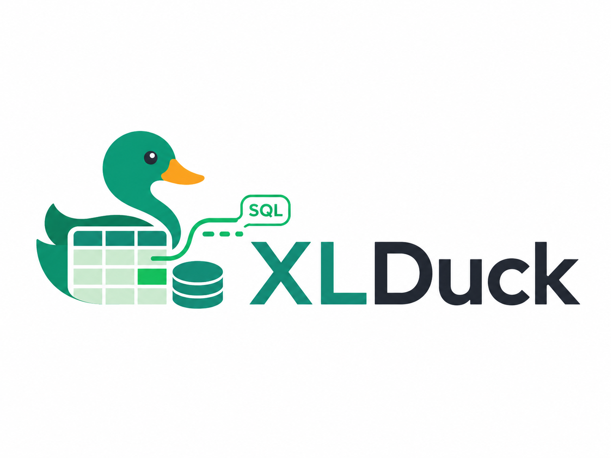
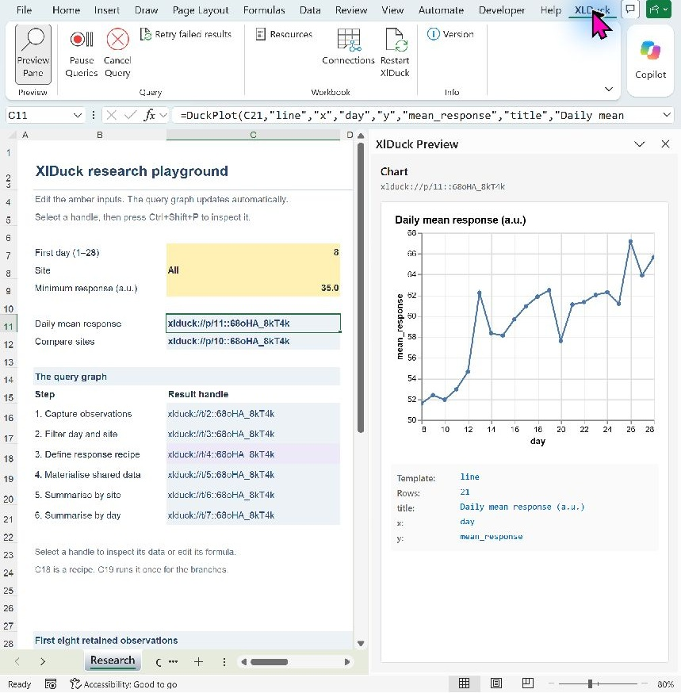
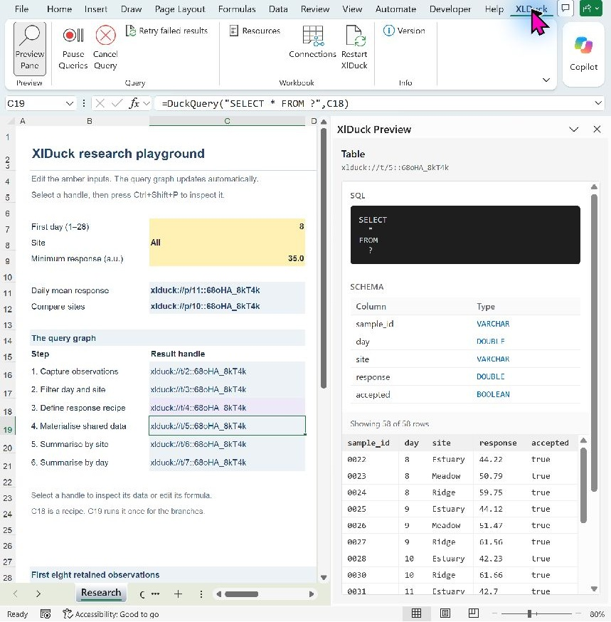

<p align="center"></p>

# XlDuck

XlDuck lets researchers build SQL analyses through Excel cells. DuckDB computes tables in a worker process; cells hold handles that connect sources, intermediate analyses, outputs and charts. Excel owns the dependency graph. AI working inside Excel can write the SQL and inspect results through the same worksheet functions.

**[Download 0.2.0-preview.1 for Windows x64](https://github.com/jamtho/xlduck/releases/tag/v0.2.0-preview.1)**. This first public preview replaces the old shared engine and unrestricted configuration API. It is unsigned; installation and native Excel tests have run on the development workstation. Clean-machine and broader compatibility trials are [documented follow-ups](docs/RELEASE.md#preview-scope-and-follow-up-trials).



The included demo uses synthetic observations. Selecting a plot handle displays its chart; changing a filter updates the dependent queries.

## Install

Download the ZIP from the [preview release](https://github.com/jamtho/xlduck/releases/tag/v0.2.0-preview.1), extract the complete folder and open **START-HERE.html**. After installing the x64 .NET 10 Desktop Runtime and WebView2 if needed, save your work, close Excel and run **Install.cmd**. The per-user setup copies the complete add-in to a stable folder and registers it for normal Excel startup. It includes rollback, removal and optional agent setup; no SDK is needed. See the [Windows installation guide](docs/INSTALL.md) for exact steps, manual registration and troubleshooting.

The package includes a tiny XlDuck skill ZIP for compatible Excel agents and **Install Codex Skill.cmd** for local Codex. The skill reads its detailed guidance from the installed add-in, so most upgrades need no new skill upload. See [agent setup](docs/AGENT-INTEGRATION.md#install-the-bootstrap-skill) for provider-specific availability and verification.

## Start an analysis

After installation, open **examples/research-demo/XlDuck Research Demo.xlsx** from the extracted package. The [research demo](examples/research-demo/README.md) has editable filters, a visible query graph and two preview charts, with no credentials or external data required. Save your working copy under Documents before experimenting.

XlDuck starts automatically in ordinary workbooks. Enter:

```excel
A1: =DuckQuery("SELECT range AS n FROM range(100)")
A2: =DuckQuery("SELECT n, n*n AS square FROM ? WHERE n >= ?", A1, 10)
A3: =DuckQueryOutScalar("SELECT sum(square) FROM ?", A2)
A4: =DuckPlot(A2, "line", "x", "n", "y", "square")
D1: =DuckOut(A2)
```

Select A4 and open **Preview Pane** (Ctrl+Shift+P) to see the chart. Select A1 or A2 for a table preview. Handles are opaque, workbook-session-specific references; use `DuckOut`, `DuckScalar` or `DuckInspect` to read them.



An unchanged query and unchanged typed inputs reuse their retained result. F9, Shift+F9 and unchanged F2/Enter do not fetch external data again. **Restart workbook** discards that workbook's results and recomputes them. Reopening an ordinary saved workbook starts a fresh session. Fragments are recipes; materialize a table when multiple analyses should share one source snapshot.

## Worksheet functions

| Function | Result |
| --- | --- |
| `DuckQuery(sql, arg1, …, arg8)` | Materialized table handle |
| `DuckFrag(sql, arg1, …, arg8)` | Validated SQL recipe for lazy composition |
| `DuckCapture(range)` | Table from a range whose first row contains headers |
| `DuckOut(handle, [maxRows])` | Spilled table with headers; default limit 10,000 rows |
| `DuckScalar(handle)` | Exactly one row and one column |
| `DuckQueryOut(sql, …)` | Compute and spill with headers, up to 10,000 rows |
| `DuckQueryOutScalar(sql, …)` | Compute exactly one scalar |
| `DuckPlot(handle, template, name, value, …)` | Plot handle; six option pairs |
| `DuckInspect(handle, [field])` | `schema`, `rows`, or `definition` |
| `DuckDate(serial)`, `DuckDateTime(serial)` | ISO text for explicit SQL date/timestamp casts |
| `DuckStatus()` | Workbook readiness, session and computation counts as JSON |
| `DuckCellStatus(cell)` | Per-cell execution, structured failure and Excel display status as JSON |
| `DuckSchema(sql, …)` | Column names/types without retaining source data rows |
| `DuckExplore(anchor, requestJson)` | Bounded, read-only agent inspection prototype, including start/poll |
| `DuckHelp([topic])` | Offline guidance from the installed build: index, workflow, reference, or Office.js helper |
| `DuckVersion()`, `DuckLibraryVersion()` | Add-in and engine versions |

Read the [formula and agent reference](docs/FORMULAS.md) for types, limits, fragments, chart options, source connections and recovery. `DuckExecute`, `DuckConfig`, `DuckConfigReady` and the `AfterConfig` functions have been removed.

Discover source columns with `DuckSchema` before selecting and retaining data. For large archives, retain metadata first and fetch a few text excerpts separately. **Resources** sets the workbook worker's memory, temporary disk and thread budgets (defaults: 1 GiB, 4 GiB, two threads). Applying changes restarts that workbook. `DuckCellStatus` distinguishes pending queries, SQL/source/memory failures and Excel spill errors. The optional Office.js inspection bridge has passed a live Excel agent trial; see [agent integration](docs/AGENT-INTEGRATION.md) for setup, polling and tested limits. Give an agent the starting hint: **read `DuckHelp()` and `DuckHelp("workflow")` before using XlDuck**.

## Data and access

Use positional `?` arguments for values and handles. Numeric-looking text stays text; blank cells become SQL NULL; empty text remains empty text. Exact decimals and integers beyond Excel's exact numeric range return text. Choose `CAST AS DOUBLE` explicitly when approximation is appropriate, including for decimal chart values. Mixed text/numeric captured columns fail with an actionable error instead of coercing the data silently.

Worksheet SQL supports read-and-compute SELECT queries and curated CSV, JSON, Parquet, text and blob readers. It cannot write/export data, install extensions, attach databases or change settings. An ordinary workbook has broad read access under your account and configured credentials. This is **not a sandbox for hostile workbooks**: readable data can be returned or sent to remote URLs. The separate worker provides fault isolation.

Protected View workbooks do not run XlDuck queries. Excel's **Enable Editing** transition starts a fresh session; ordinary workbooks, including new books and copies, run automatically. XlDuck does not change Trust Center settings or add a separate approval dialog. A workbook that bypasses Protected View can therefore execute its read-and-compute formulas.

Use **XlDuck > Connections** for S3-compatible storage. Configure an endpoint, bucket/path and saved access key, environment credentials or anonymous access. HTTPS and path-style addressing are advanced settings; profile providers remain optional. XlDuck supplies the protocol's signing-region default internally. Settings are stored locally by workbook path, independently of its file contents. Save As carries those settings to the new path; a copy at another path starts with defaults. Saved keys live in Windows Credential Manager and are not written to workbook settings or cells.

Automatic calculation is the primary mode. In manual mode, explicitly calculate to start work and calculate again after completion to propagate it; an asynchronous chain may need several passes. XlDuck changes neither Excel's calculation mode nor its global RTD interval.

## Development on Windows

Requires 64-bit desktop Excel, a .NET SDK supporting the .NET 8 API target, the **x64 .NET 10 Desktop Runtime** for the intended public deployment, and WebView2 for the pane. The add-in and worker roll forward to the newest available compatible runtime. See [release preparation](docs/RELEASE.md) for tested load orders and remaining deployment checks; this is an unsigned public preview.

Acquire the exact dependencies and build from the repository root:

```powershell
powershell -NoProfile -ExecutionPolicy Bypass -File scripts/Get-ReaderExtensions.ps1
powershell -NoProfile -ExecutionPolicy Bypass -File scripts/Get-PreviewAssets.ps1
dotnet build XlDuck -m:1 /nodeReuse:false /p:UseSharedCompilation=false
powershell -NoProfile -ExecutionPolicy Bypass -File tests/Run-Tests.ps1 -NoBuild -WithPreview
```

The add-in is a **folder distribution**, including `worker`, `readers` and `preview`. Open `XlDuck/bin/Debug/net8.0-windows/XlDuck-AddIn64.xll`; do not copy the XLL alone. Only 64-bit builds are produced. Chart libraries are bundled and work offline; map tiles still come from OpenStreetMap or Esri and reveal the requested map viewport to that provider.

For an owned visible development instance:

```powershell
powershell -NoProfile -ExecutionPolicy Bypass -File scripts/Reload-AddIn.ps1
```

This opens a new Excel instance with a private copy of the build. It leaves existing Excel instances alone. Close development instances yourself. If a build output is in use, use a fresh directory with `dotnet build XlDuck --artifacts-path artifacts/my-build`; the XLL is then under `artifacts/my-build/bin/XlDuck/debug/`. The test scripts accept `-AddInPath` for such builds.

See [tests](tests/README.md), [architecture](ARCHITECTURE.md), [capability policy](XlDuck.Engine/README.md) and [the modernization plan](PLAN-modernization.md). Logs under `%LOCALAPPDATA%/XlDuck` contain bounded lifecycle diagnostics, without routine SQL, arguments or provider exception messages.

## Licence

XlDuck is licensed under MPL-2.0. Bundled dependencies retain their own licences; see [third-party notices](THIRD-PARTY-NOTICES.md).
